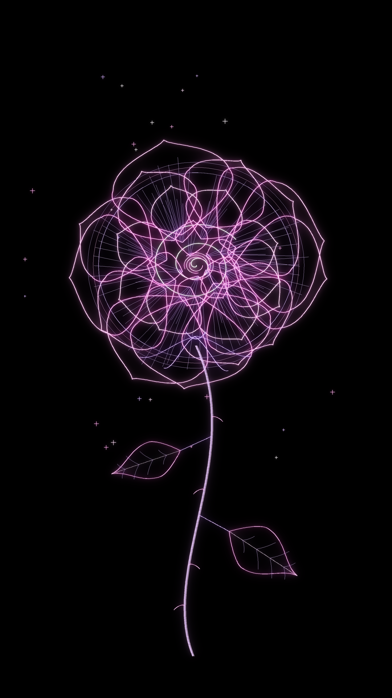
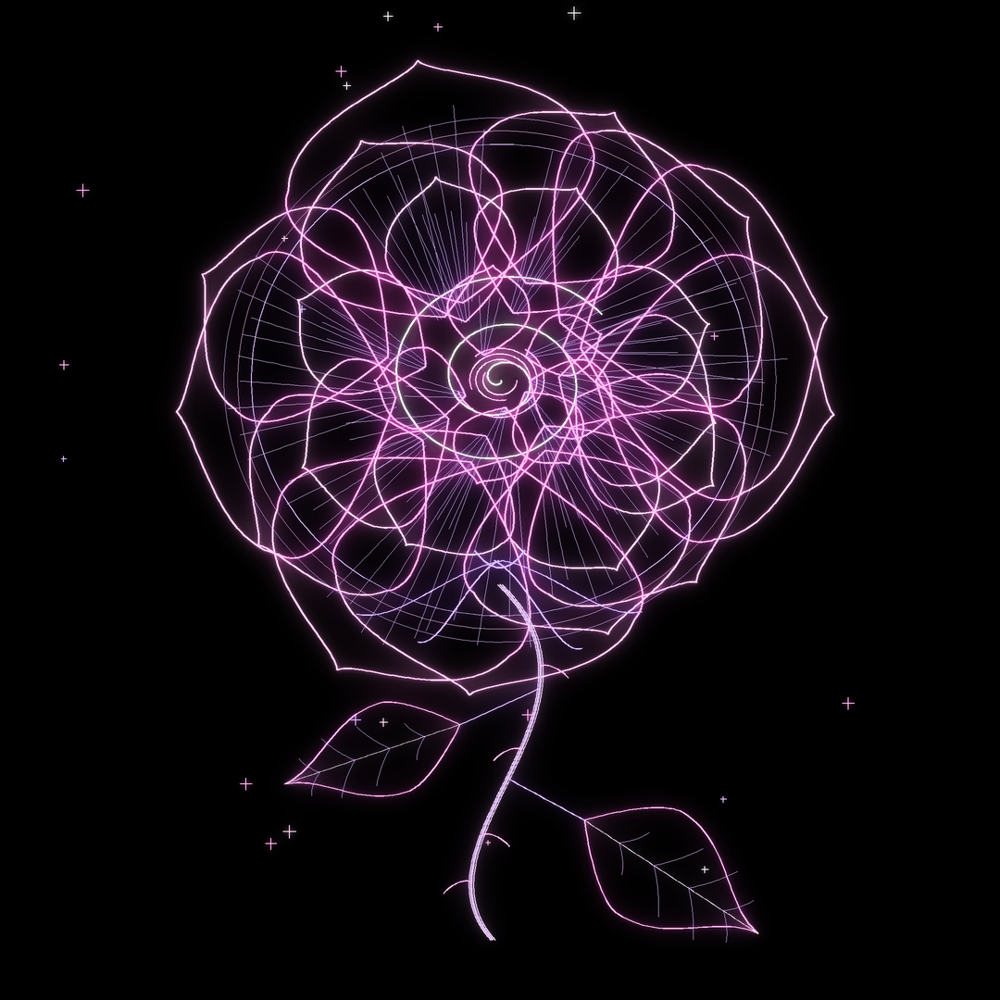
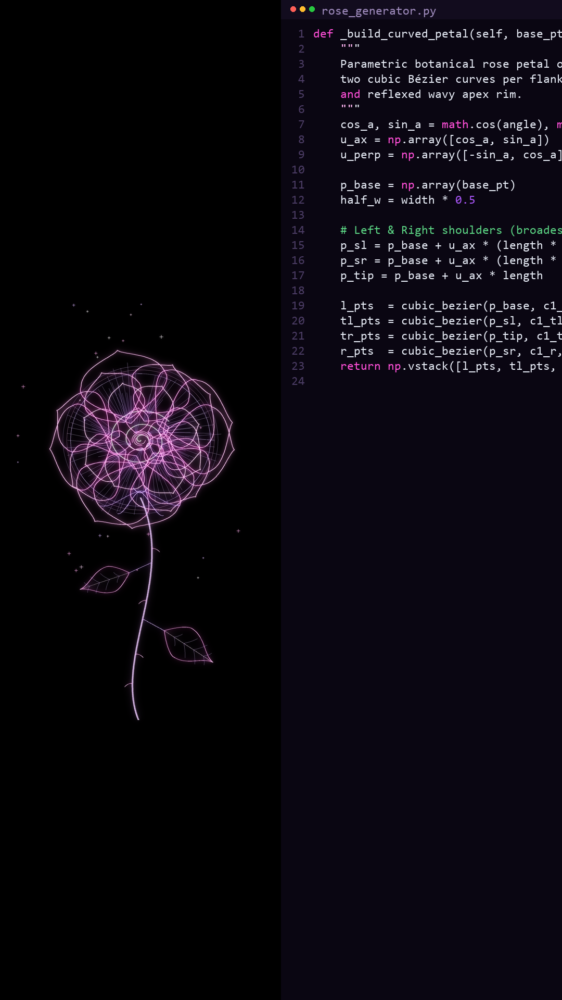

# 🌹 NEON ROSE — Generative Art & Vector Motion Engine

[](https://python.org)
[](https://streamlit.io)
[](https://python-pillow.org)
[](https://zulko.github.io/moviepy/)
[](LICENSE)

> A deterministic mathematical art engine that transforms parametric equations, logarithmic spiral whorls, and cubic Bézier splines into an intricate, glowing pink neon botanical rose rendered in real-time on a pure cinematic black background.

Created by **hxni** • Connect on Instagram: **[@the.cipher.stack](https://instagram.com/the.cipher.stack)**

---

## 📸 Visual Showcase

| Vertical 9:16 Reel (1080×1920) | Square Format (1080×1080) | Split Code Panel View |
| :---: | :---: | :---: |
|  |  |  |

---

## ⚡ Core Architecture

```
                                  [ User Request / Seed ]
                                             │
                                             ▼
                                  ┌──────────────────────┐
                                  │   RoseConfig Entity  │
                                  └──────────┬───────────┘
                                             │
                                             ▼
                                 ┌────────────────────────┐
                                 │   RoseGenerator (Math) │
                                 └──────────┬─────────────┘
                                            │
                       ┌────────────────────┴────────────────────┐
                       ▼                                         ▼
            ┌──────────────────────┐                  ┌──────────────────────┐
            │   60 FPS Web Canvas  │                  │  Headless Renderers  │
            │  (Progressive Vector │                  │   (Pillow / NumPy)   │
            │   Stroke Animation)  │                  └──────────┬───────────┘
            └──────────────────────┘                             │
                                            ┌────────────────────┴───────────────────┐
                                            ▼                                        ▼
                                ┌─────────────────────────┐              ┌─────────────────────────┐
                                │   4-Pass Glow Composite │              │   H.264 Video Exporter  │
                                │   (Bloom + Core Art)    │              │  (MoviePy / OpenCV / FF)│
                                └─────────────────────────┘              └─────────────────────────┘
```

The system is decomposed into decoupled, single-responsibility modules:

1. **`src/path_geometry.py`**: Pure mathematical foundations — cubic and quadratic Bézier evaluation, centripetal Catmull-Rom interpolation, arc-length parameterization, 2D affine rotations, and partial stroke truncation.
2. **`src/rose_generator.py`**: Generative botanical engine computing 200+ distinct parametric curve paths using golden angle phyllotaxis ($\approx 137.5^\circ$), logarithmic spiral cores, and organic leaflet venation.
3. **`src/neon_renderer.py`**: Multi-pass photonic glow pipeline simulating the physical dispersion and luminous core of high-voltage neon gas discharge tubes.
4. **`src/animation_engine.py`**: Phase-coordinated stroke timeline generating interpolated frames with cubic ease-in-out transitions and camera holding.
5. **`src/video_exporter.py`**: High-throughput video rendering pipeline supporting native H.264 MP4 export (`yuv420p` profile) with multi-backend fallback (`MoviePy 2.x` $\rightarrow$ `OpenCV` $\rightarrow$ `FFmpeg`).
6. **`src/composition.py`**: High-level layout assembler for social media presets, typographic quote overlays, and syntax-highlighted IDE split views.
7. **`app.py`**: Zero-distraction runtime rendering the rose drawing live on a pure `#000000` canvas at 60 FPS upon launch.

---

## 📐 Mathematical Formulation

### 1. Central Bud & Logarithmic Spiral Whorl
The center of the rose bud is modeled as a generalized logarithmic spiral with perspective foreshortening:

$$r(\theta) = a \cdot \theta^b, \quad \theta \in [0.4, 5.8\pi]$$

$$\begin{cases} x(\theta) = c_x + r(\theta)\cos(\theta) \\ y(\theta) = c_y + r(\theta)\sin(\theta) \cdot \lambda \end{cases}$$

where $\lambda \approx 0.88$ introduces botanical vertical compression to simulate a three-dimensional tilted perspective.

### 2. Petal Geometry (Curved Cubic Bézier Splines)
Each petal is formed by a closed loop of 4 interconnected cubic Bézier curves:
- **Left flank**: Base anchor $\mathbf{P}_0 \rightarrow$ left shoulder $\mathbf{P}_{\text{SL}}$
- **Apex left rim**: Left shoulder $\mathbf{P}_{\text{SL}} \rightarrow$ petal tip $\mathbf{P}_{\text{tip}}$
- **Apex right rim**: Petal tip $\mathbf{P}_{\text{tip}} \rightarrow$ right shoulder $\mathbf{P}_{\text{SR}}$
- **Right flank**: Right shoulder $\mathbf{P}_{\text{SR}} \rightarrow$ base anchor $\mathbf{P}_0$

$$\mathbf{B}(t) = (1-t)^3 \mathbf{P}_0 + 3(1-t)^2 t \mathbf{P}_1 + 3(1-t) t^2 \mathbf{P}_2 + t^3 \mathbf{P}_3, \quad t \in [0, 1]$$

### 3. Golden Ratio Phyllotactic Distribution
To prevent unnatural radial alignment, petal azimuths are distributed along the Golden Angle:

$$\theta_n = n \cdot \Phi, \quad \Phi = \pi(3 - \sqrt{5}) \approx 137.5077^\circ$$

### 4. 4-Pass Photonic Glow Pipeline
A neon gas tube is physically characterized by a white-hot electrical arc surrounded by exponentially attenuating gas emissions. This is synthesized via 4 independent rendering passes:

$$\mathbf{I}_{\text{final}} = \mathbf{I}_{\text{bloom}} \oplus \mathbf{I}_{\text{aura}} \oplus \mathbf{I}_{\text{inner}} \oplus \mathbf{I}_{\text{core}}$$

$$\mathbf{I}_{\text{layer}} = \mathcal{G}_{\sigma_k} \ast \mathbf{S}_k(w_k, \alpha_k, \mathbf{C}_k)$$

| Layer | Kernel Radius ($\sigma$) | Line Width ($w$) | Color Temperature | Opacity ($\alpha$) | Function |
| :--- | :--- | :--- | :--- | :--- | :--- |
| **Pass 1: Bloom** | $0.016 \times W$ | $8.0 \times w_0$ | Magenta / `#FF4FD8` | $0.25 - 0.45$ | Wide atmospheric aura |
| **Pass 2: Aura** | $0.007 \times W$ | $3.8 \times w_0$ | Hot Pink / `#FF2EB3` | $0.50 - 0.70$ | Saturated photon body |
| **Pass 3: Inner** | $0.0025 \times W$ | $1.8 \times w_0$ | Soft Pink / `#FFB5F2` | $0.80 - 0.90$ | Localized core glow |
| **Pass 4: Core** | $0$ (Unblurred) | $0.85 \times w_0$ | White-hot / `#FFF5FB` | $1.00$ | Razor-sharp crisp line |

---

## 🚀 Quickstart

### Prerequisites
- Python 3.11, 3.12, or 3.14
- Git

### 1. Clone & Set Up Virtual Environment

```powershell
# Clone repository
git clone https://github.com/your-username/neon-rose.git
cd neon-rose

# Create & activate virtual environment (Windows PowerShell)
python -m venv .venv
.\.venv\Scripts\Activate.ps1

# (On Linux / macOS)
# python3 -m venv .venv
# source .venv/bin/activate
```

### 2. Install Dependencies

```powershell
pip install -r requirements.txt
```

### 3. Launch

```powershell
streamlit run app.py
```

The application will launch on `http://localhost:8501`. Upon opening, all menus and sidebars are suppressed, and the glowing neon rose draws itself onto the screen.

- **Replay / Redraw**: Click anywhere on the screen or press `Space` / `R`.

---

## 📦 Directory Structure

```
neon-rose/
├── app.py                     # Streamlit entrypoint (cinematic 60 FPS canvas)
├── requirements.txt           # Production dependencies
├── README.md                  # System architecture and technical documentation
├── src/
│   ├── __init__.py            # Package manifest
│   ├── path_geometry.py       # Parametric math, Bézier curves, arc interpolation
│   ├── rose_generator.py      # Botanical rose mathematics engine
│   ├── neon_renderer.py       # 4-layer neon glow compositor & code panel
│   ├── animation_engine.py    # Multi-phase progressive stroke timeline
│   ├── video_exporter.py      # MP4 (MoviePy / OpenCV / FFmpeg) & PNG exporter
│   └── composition.py         # Canvas framing, split screen, and preset assembler
├── assets/
│   └── fonts/                 # Optional custom typography (.ttf)
└── output/
    ├── .gitkeep
    ├── test_rose_seed42_1080x1920.png  # Vertical Reel reference render
    ├── test_rose_seed42_1080x1080.png  # Square reference render
    ├── test_rose_codepanel.png         # Split-screen code panel render
    └── test_animation_540x960.mp4      # MP4 animation reference export
```

---

## 🛠️ Programmatic Python API

Generate high-resolution still frames or batch-render animations programmatically:

### High-Resolution PNG Export
```python
from pathlib import Path
from src.rose_generator import RoseConfig, RoseGenerator
from src.composition import build_rose_image
from src.video_exporter import export_png

# Configure rose parameters
cfg = RoseConfig(
    seed=42,
    canvas_w=1080,
    canvas_h=1920,
    n_inner=6,
    n_middle=9,
    n_outer=13,
    stem_curvature=0.35,
    n_leaves=3,
    primary_color="#FF4FD8",
    glow_intensity=1.2,
)

# Generate parametric geometry
geo = RoseGenerator(cfg).generate()

# Render with 2x supersampling and glowing quote
img = build_rose_image(
    geo,
    glow_intensity=1.2,
    supersampling=2,
    quote="Some things bloom in silence."
)

export_png(img, Path("output/my_rose.png"), target_width=1080, target_height=1920)
print("Artwork exported successfully.")
```

### Video Rendering (MP4)
```python
from pathlib import Path
from src.rose_generator import RoseConfig, RoseGenerator
from src.animation_engine import collect_frames
from src.video_exporter import export_mp4

cfg = RoseConfig(seed=42, canvas_w=1080, canvas_h=1920)
geo = RoseGenerator(cfg).generate()

# Render frames (9s progressive drawing + 3s hold at 30 FPS)
frames = collect_frames(
    geo,
    fps=30,
    drawing_duration=9.0,
    hold_duration=3.0,
    glow_intensity=1.2,
    supersampling=2,
)

export_mp4(frames, Path("output/rose_reel.mp4"), fps=30, quality=8)
```

---

## 🎨 Social Media Presets

| Preset | Target Platform | Resolution | Aspect Ratio | Export Type |
| :--- | :--- | :--- | :--- | :--- |
| **Instagram Reel / Shorts** | Reels, TikTok, YouTube Shorts | $1080 \times 1920$ | 9:16 | H.264 MP4 / PNG |
| **Square Feed** | Instagram Grid, Twitter / X | $1080 \times 1080$ | 1:1 | PNG |
| **Portrait Artwork** | Instagram Portrait | $1080 \times 1350$ | 4:5 | PNG |
| **Ultra HD Vertical** | 4K Displays, Motion Backgrounds | $2160 \times 3840$ | 9:16 | H.264 MP4 |

---

## 👨‍💻 Credits & Author

- **Core Concept & Engineering**: **hxni**
- **Instagram**: [**@the.cipher.stack**](https://instagram.com/the.cipher.stack)

*Feel free to star the repo, fork the project, tag **@the.cipher.stack** in your generative art reels, and explore the mathematical beauty of generative computing!*
